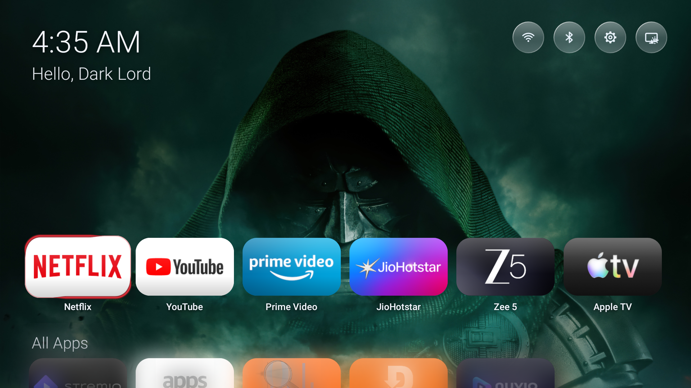
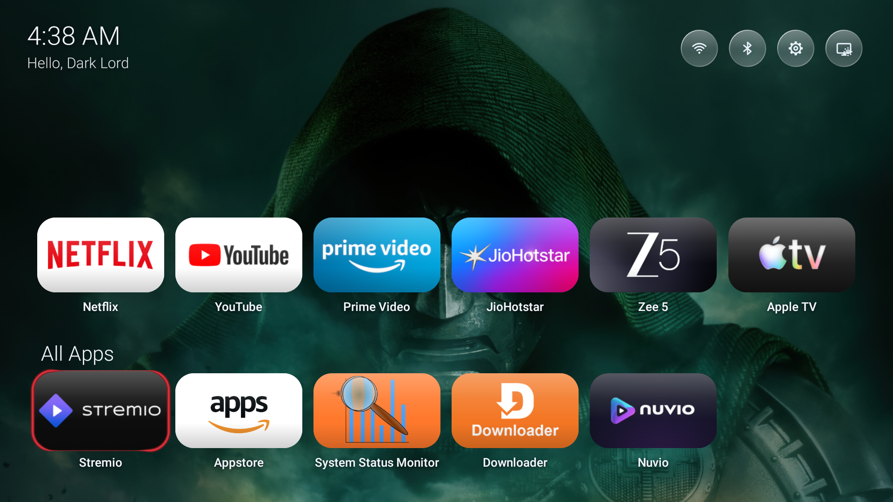
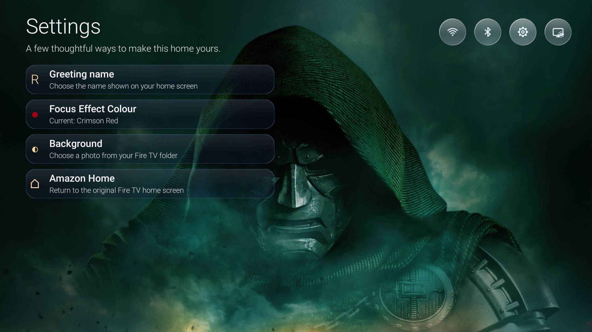

# Liquid Home

**A remote-friendly Android TV launcher project for Fire TV.** Liquid Home organizes installed apps, lets you choose a home-screen background, and includes optional catalog search and device personalization.

[](LICENSE)
[](#compatibility)

> **Current build warning:** this checkout has a known source/resource mismatch. `Home.java` refers to `R.drawable.tmdb_logo`, but the corresponding drawable is absent from `liquid-home/res/`. A clean build is expected to fail until that mismatch is resolved. No APK is provided here.

## About the project

Liquid Home is a Java launcher with Android HOME and Leanback launcher entry points. It is intended for use with a TV remote: the home screen has an app row, an All Apps view, and pages for search and settings.

The project may interest Fire TV owners who want to explore an alternative launcher, and Android developers interested in a small, direct Android SDK build. Fire OS controls how the physical Home button is routed, so installing this app does not guarantee that the device will open it when Home is pressed.

## Features

- **App organization:** browse launchable installed apps, move apps between All Apps and a six-item Main Row, and reorder the Main Row with the remote.
- **Backgrounds:** select the built-in background or custom images. Transfer images from a phone/browser over the local network, or copy images from a computer to the TV with ADB.
- **Optional catalog search:** search TMDB for movies, television, and people. Search requires an internet connection and a user-provided TMDB API Read Access Token, which the app encrypts on the device.
- **Personalization:** set the greeting name and select a focus-effect color in Settings.
- **Fire TV shortcuts:** open Fire TV settings or return to Amazon Home from the app.
- **Optional Home Keeper:** a best-effort service for certain older Fire OS versions. Its behavior depends on device firmware and does not control the physical Home button.

## Screenshots

These screenshots were captured from Liquid Home running on a Fire TV.

### Home screen



### All Apps


### All Apps deck



### Settings



## Compatibility

| Item | Configuration or status |
|---|---|
| Android package | `tv.rajra.liquidhome` |
| Minimum SDK | API 25 |
| Target SDK | API 25 |
| Launcher intents | Android HOME and Leanback launcher |
| Intended device | Fire TV |
| Verified compatibility | One Fire TV was manually exercised; the tested model and Fire OS version are not documented here. |
| Other devices | Compatibility across other Fire TV models, Fire OS versions, and Android TV devices has not been established. |

The manifest marks the Leanback feature as optional. That declaration does not establish compatibility with every Android TV device. The installation script specifically identifies Fire TV devices.

## Installation on Fire TV

Installation is performed from Windows PowerShell using the project scripts. Review [Prerequisites](PREREQUISITES.md) before starting. The current clean-checkout build limitation above must be resolved before installation can succeed.

1. On Fire TV, enable **ADB Debugging** in **Settings → My Fire TV → Developer Options**. If Developer Options are hidden, open **About**, highlight the device name, and press Select seven times; menu wording varies by firmware.
2. Connect the computer and TV to the same network, wake the TV, and find its current IPv4 address.
3. From PowerShell in the project directory, check the device:

   ```powershell
   .\scripts\preflight.ps1 -TvIp "192.168.1.50"
   ```

4. Install and launch Liquid Home:

   ```powershell
   .\install.ps1 -TvIp "192.168.1.50" -DisplayName "Alex"
   ```

   Replace the example address and name with your own. The script builds the APK, installs it with `adb install -r`, and launches the app. It does not uninstall an existing installation. If prompted on the TV, approve the ADB authorization and choose **Always allow from this computer**.

The installer saves device settings used by the optional Keeper workflow. To stop Keeper, restore saved settings when a snapshot is available, and open Amazon Home, run:

```powershell
.\restore-amazon-home.ps1 -TvIp "192.168.1.50"
```

See [Troubleshooting](docs/TROUBLESHOOTING.md) for ADB, signing, installation, and recovery guidance.

## Build from source

The build uses Windows PowerShell 5.1, JDK 17, Android SDK Platform 25, and Android Build Tools 34.0.0. It uses the Android SDK tools directly; Gradle and Android Studio are not required. `setup-tools.ps1` can find or provision a JDK and the required SDK components. SDK setup may download files and asks you to review and accept Google's Android SDK terms before installing missing SDK packages.

Clone the repository and enter its directory:

```powershell
git clone https://github.com/Darklord9156/Liquid-Home.git
cd Liquid-Home
```

Set up the toolchain and build:

```powershell
.\setup-tools.ps1
.\liquid-home\build.ps1 -DisplayName "Alex"
```

The display name is optional; it sets the first-use greeting default. The build script writes the APK to `liquid-home/build/liquid-home.apk` and signs it with a developer-local key. A newly generated key cannot update an installation signed by a different key. Keep your keystore and its password private; they are not included in the repository.

To verify a built APK, run:

```powershell
.\verify.ps1 -ExpectedDisplayName "Alex"
```

**The current checkout is expected to fail during a clean build** because of the missing `tmdb_logo` resource described above. These commands document the intended workflow; they are not a claim that the current build succeeds.

## Project structure

| Path | Purpose |
|---|---|
| `liquid-home/src/tv/rajra/liquidhome/` | Launcher activity and Java helper classes. |
| `liquid-home/AndroidManifest.xml` | Package ID, launcher entry points, permissions, service, and boot receiver. |
| `liquid-home/res/` | App icons, theme values, and XML resources. |
| `liquid-home/build.ps1` | Direct Android SDK compilation, packaging, alignment, and signing workflow. |
| `setup-tools.ps1` | JDK selection/provisioning and local Android SDK setup. |
| `install.ps1`, `scripts/preflight.ps1` | Fire TV checks and installation. |
| `verify.ps1` | APK signature, package, resource, and input-freshness checks. |
| `restore-amazon-home.ps1` | Recovery workflow for returning to Amazon Home. |
| `sync-wallpapers.ps1`, `wallpapers/` | Computer-to-TV wallpaper sync script and source images. |
| `tests/` | PowerShell project checks and Java wallpaper/QR tests. |
| `docs/`, `PREREQUISITES.md` | Troubleshooting and toolchain documentation. |
| `LICENSE`, `liquid-home/THIRD_PARTY_NOTICES.txt` | Project license and third-party notices. |

## Automated checks

The project check script is:

```powershell
.\tests\Project.Tests.ps1
```

It runs source-pattern checks, PowerShell parser checks, and Java loopback tests. It does not test the rendered TV interface or verify compatibility across devices. No test result is claimed in this README; use the output from your own run.

## Known limitations

- A clean build is expected to fail while the `tmdb_logo` source/resource mismatch remains unresolved.
- Physical Home-button routing is controlled by Fire OS. Home Keeper is optional, firmware-dependent, and best-effort.
- Only one Fire TV has been manually exercised; broader device compatibility is unknown.
- Phone/browser wallpaper transfer uses local HTTP without TLS. Use a trusted network and keep the temporary upload URL private.
- The repository does not establish redistribution permission for its bundled wallpaper and logo artwork. Those permissions remain to be reviewed before redistributing the assets.
- There is no shared release-signing process. A developer's local signing key is not suitable for publishing updates to every user's installation.

## Contributing

Contributions are welcome. Before opening a pull request, describe the change and how you checked it, including device and Fire OS details when relevant. Keep signing files, ADB keys, device snapshots, API tokens, and private network details out of commits and issue reports. Do not report tests as passing unless you ran them and confirmed the result.

## License

Liquid Home's original project code is licensed under the [MIT License](LICENSE). Third-party components retain their own notices and terms; see [`liquid-home/THIRD_PARTY_NOTICES.txt`](liquid-home/THIRD_PARTY_NOTICES.txt). The project license does not grant redistribution rights to third-party artwork or other material.

## More information

- [Prerequisites and toolchain](PREREQUISITES.md)
- [Troubleshooting](docs/TROUBLESHOOTING.md)
- [Change map](CHANGE_MAP.md)
